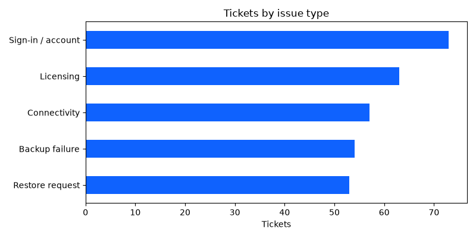
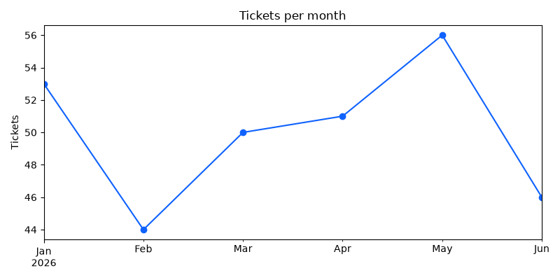

# Support Ticket Insights Report

## Executive summary

Across 300 tickets, your team hit a 76% SLA compliance rate. "Sign-in / account" issues drive your highest volume (24% of all tickets). "Licensing" is your primary bottleneck, averaging nearly 28 hours to resolve. Crucially, "Restore requests" have your worst SLA compliance (73.6%) despite having the fastest average resolution time (16 hours), signaling inconsistent triage for time-critical recovery issues.

**Recommendations:**
1. **Automate account recovery:** Deploy self-service reset tools to immediately deflect your highest-volume ticket category.
2. **Streamline licensing approvals:** Audit the licensing workflow and empower frontline agents with pre-approvals to cut down the 27.6-hour turnaround.
3. **Fast-track restore tickets:** Implement dedicated routing and immediate escalation alerts for data restores so strict SLAs aren't breached during urgent incidents.

## Results by issue type

| category          |   tickets |   avg_hours |   sla_met_pct |
|:------------------|----------:|------------:|--------------:|
| Sign-in / account |        73 |        18.9 |          78.1 |
| Licensing         |        63 |        27.6 |          76.2 |
| Connectivity      |        57 |        21   |          75.4 |
| Backup failure    |        54 |        25.9 |          75.9 |
| Restore request   |        53 |        16   |          73.6 |

